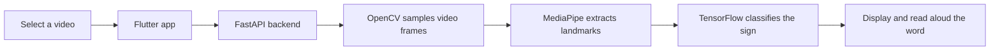

# SignSpeak

**Bridging communication through Indian Sign Language.**

Millions of deaf and hard-of-hearing individuals rely on Indian Sign Language (ISL) for communication. Unfortunately, many people are unable to understand sign language, creating barriers in education, healthcare, workplaces, and everyday interactions.

SignSpeak addresses this challenge by enabling automatic recognition of ISL gestures and translating them into text and speech. SignSpeak is an AI-powered Indian Sign Language (ISL) recognition system designed to bridge the communication gap between sign language users and non-signers. The application translates ISL gestures from videos into readable text and speech using MediaPipe landmark extraction, TensorFlow deep learning models, a FastAPI backend, and a Flutter frontend

## Technology

- **Frontend:** Flutter and Dart
- **Backend:** Python, FastAPI, and Uvicorn
- **Video processing:** OpenCV
- **Hand and pose landmarks:** MediaPipe
- **Sign classification:** TensorFlow/Keras

## Recognition flow

